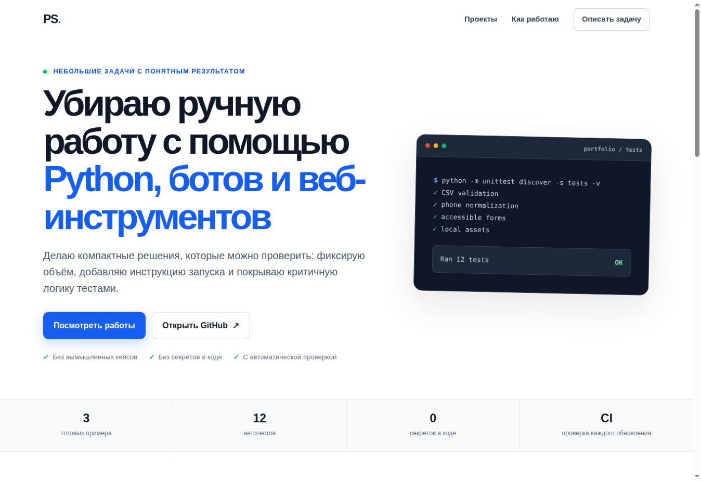

# Developer Portfolio — Python Automation, Telegram Bots, Web

[](https://github.com/smolaps01-hash/developer-portfolio/actions/workflows/tests.yml)

[](LICENSE)

Практическое портфолио разработчика: небольшие задачи автоматизации, Telegram-боты и адаптивные веб-страницы. Каждый пример имеет ограниченный и проверяемый объём, инструкцию запуска и автоматические тесты.

**[Открыть живую витрину](https://smolaps01-hash.github.io/developer-portfolio/)** · **[Проверить тесты](https://github.com/smolaps01-hash/developer-portfolio/actions)** · **[Описать задачу](https://github.com/smolaps01-hash/developer-portfolio/issues/new?template=project_request.yml)**



## Чем могу помочь

- автоматизировать обработку CSV/Excel-выгрузок и подготовку отчётов;
- сделать Telegram-бота для заявок, анкет или уведомлений;
- собрать или доработать адаптивную одностраничную страницу;
- проверить небольшой Python-проект, добавить валидацию и тесты;
- оформить понятную инструкцию запуска и передачи результата.

## Проекты

| Проект | Что показывает | Проверка |
| --- | --- | --- |
| [CSV Report Automation](csv_automation/) | Валидация CSV, расчёты с `Decimal`, JSON-отчёт | 4 теста |
| [Telegram Lead Bot](telegram_lead_bot/) | FSM-сценарий, телефонная валидация, SQLite, секреты через окружение | 5 тестов |
| [Responsive Landing Page](landing/) | Семантичный HTML, адаптивный CSS, доступная форма, JS | 3 теста |

Всего: **17 автоматических тестов**. Они запускаются локально и при каждом обновлении через GitHub Actions.

## Быстрый запуск

Нужен Python 3.11+ (в GitHub Actions используется 3.12).

```bash
git clone https://github.com/smolaps01-hash/developer-portfolio.git
cd developer-portfolio
python -m unittest discover -s tests -v
```

Пример CSV-отчёта:

```bash
python csv_automation/report.py csv_automation/sample.csv --output report.json
```

Бот (токен не записывается в код):

```bash
python -m venv .venv
source .venv/bin/activate  # Windows: .venv\Scripts\activate
pip install -r telegram_lead_bot/requirements.txt
export BOT_TOKEN="полученный_у_BotFather_токен"  # Windows PowerShell: $env:BOT_TOKEN="..."
python -m telegram_lead_bot.bot
```

Лендинг и витрину можно открыть как обычные HTML-файлы: `landing/index.html` и `docs/index.html`.

## Как начинается работа

1. Вы описываете исходные данные, желаемый результат и срок.
2. Я уточняю объём, ограничения и критерии приёмки.
3. Для небольшой задачи согласуем фиксированный результат и стоимость.
4. Вы получаете код, инструкцию и проверку результата.

Для первичного описания можно использовать [шаблон задачи](https://github.com/smolaps01-hash/developer-portfolio/issues/new?template=project_request.yml). Не вставляйте туда пароли, токены, банковские данные или закрытые клиентские файлы.

На [живой витрине](https://smolaps01-hash.github.io/developer-portfolio/#brief) есть локальный конструктор заявки: он собирает текст прямо в браузере, ничего не отправляет на сервер и позволяет скопировать готовое описание для чата или биржи.

## Безопасность и честные ограничения

- Это демонстрационные проекты, а не вымышленные клиентские кейсы.
- Секреты, токены и персональные данные не хранятся в репозитории.
- Код проверяется автоматическими тестами, но развёртывание и платные сервисы согласуются отдельно.
- Реальные клиентские данные лучше передавать через согласованный закрытый канал и в минимальном объёме.
- Найденные проблемы безопасности описаны в [SECURITY.md](SECURITY.md).

## Структура

```text
csv_automation/       CSV → проверка → JSON-отчёт
telegram_lead_bot/    Telegram-заявки → SQLite
landing/              демонстрационный адаптивный лендинг
docs/                 живая витрина для GitHub Pages
proposals/            шаблоны честных откликов на заказы
tests/                автоматические тесты
.github/               CI и шаблон постановки задачи
AUDIT.md               аудит доверия, конверсии и технического качества
```

## Лицензия

[MIT](LICENSE) — демонстрационный код можно изучать и адаптировать с сохранением уведомления об авторстве.

